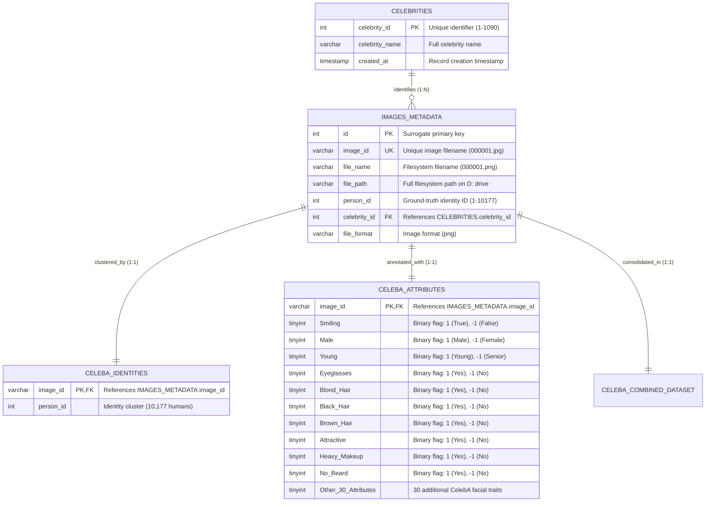

# Enhanced Entity-Relationship (EER) Diagram: `celeba_db`

This document defines the formal **Enhanced Entity-Relationship (EER)** model for the `celeba_db` relational database supporting the CelebA facial attribute classification and recognition system.

---

## 1. Visual EER Diagram

---

## 2. Entity Descriptions & Schema Specifications

### Table 1: `celebrities`

* **Purpose**: Master reference dimension for verified celebrity personalities ($1{,}090$ records).
* **Primary Key**: `celebrity_id` (`INT AUTO_INCREMENT`)
* **Key Columns**:
  * `celebrity_name` (`VARCHAR(150)`): Recognized celebrity stage name (e.g., *Keanu Reeves*, *Scarlett Johansson*).
  * `created_at` (`TIMESTAMP`): Auditing timestamp.

### Table 2: `images_metadata`

* **Purpose**: Central fact table storing file system links, image metadata, and foreign key relations for all $202{,}599$ face crops.
* **Primary Key**: `id` (`INT AUTO_INCREMENT`)
* **Candidate / Unique Key**: `image_id` (`VARCHAR(32)`)
* **Foreign Keys**:
  * `celebrity_id` $\rightarrow$ `celebrities.celebrity_id`
* **Indexes**: `idx_image_id`, `idx_celeb_id`, `idx_person_id`

### Table 3: `celeba_identities`

* **Purpose**: Ground-truth face identity clustering provided by official CelebA annotations ($202{,}599$ rows mapping to $10{,}177$ distinct humans).
* **Primary Key**: `image_id` (`VARCHAR(32)`)
* **Foreign Key**: `image_id` $\rightarrow$ `images_metadata.image_id` (1:1 Relationship)
* **Index**: `idx_pid (person_id)` for sub-millisecond cluster aggregation.

### Table 4: `celeba_attributes`

* **Purpose**: Multi-label classification ground-truth matrix for $40$ binary facial traits.
* **Primary Key**: `image_id` (`VARCHAR(32)`)
* **Foreign Key**: `image_id` $\rightarrow$ `images_metadata.image_id` (1:1 Relationship)
* **Encoding**: `1` = Attribute Present, `-1` = Attribute Absent.

---

## 3. Relationships & Cardinality

| Relationship | Source Entity | Target Entity | Cardinality | Constraint | Description |
| :--- | :--- | :--- | :---: | :---: | :--- |
| **Identifies** | `celebrities` | `images_metadata` | **1 : N** | `ON DELETE RESTRICT` | One celebrity has many photos; each photo corresponds to a celebrity. |
| **Clustered By** | `images_metadata` | `celeba_identities` | **1 : 1** | `ON DELETE CASCADE` | Every photo has exactly one verified person identity cluster. |
| **Annotated** | `images_metadata` | `celeba_attributes` | **1 : 1** | `ON DELETE CASCADE` | Every photo has exactly one set of 40 binary attribute annotations. |
| **Consolidated** | `images_metadata` | `celeba_combined_dataset` | **1 : 1** | `ON DELETE CASCADE` | Every photo has a unified record in the combined physical table. |

---

## 4. How to Generate in MySQL Workbench

To visualize this EER diagram interactively in **MySQL Workbench**:

1. Open **MySQL Workbench**.
2. Connect to local server `127.0.0.1:3306` (User: `root`).
3. In the top menu, select **Database > Reverse Engineer...** (or press `Ctrl + R`).
4. Select database `celeba_db` and click **Next > Execute**.
5. MySQL Workbench will automatically layout and render the graphical EER Diagram model.
